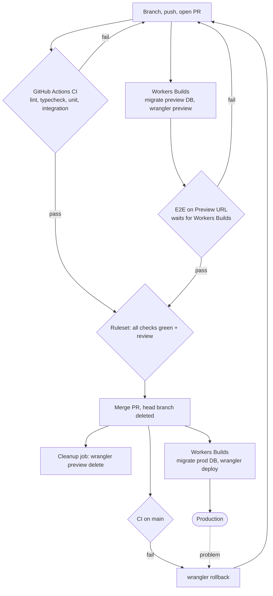

# cicd-worker

Set up CI/CD for a Cloudflare Workers repository so that every branch gets an isolated Preview and `main` deploys to production only after CI and a reviewed PR. Reply in the user's language (usually Indonesian); keep commands and identifiers in English.

## The flow being built



Key facts (verified against Cloudflare docs, Oct 2026; re-check https://developers.cloudflare.com/workers/previews/ when something looks different because the feature is new):
- Worker Previews needs `wrangler >= 4.135.0` in the project's own dependencies. Workers Builds uses the version in `package.json`.
- A Preview is isolated only where the `previews` block binds a *separate* resource. Missing or production-pointing bindings are the main risk. Version URLs (`wrangler versions upload`) can only reach production resources, so do not use them.
- Workers Builds runs the **build command on every branch** and then the **deploy command** (production) or **Preview command** (other branches). Therefore migrations never go in the build command. They go in the deploy command (production) and the Preview command (previews).
- Workers Builds does NOT wait for GitHub Actions: on every push both start in parallel, and on `main` the production deploy starts even if CI on `main` is still running or fails. The real gate is the PR ruleset (required checks before merge). CI on `main` is a second safety net; if it fails after merge, roll back.
- The preview name defaults to the git branch name. Workers Builds posts a GitHub check run named `Workers Builds: <worker>`.

## Defaults already agreed (do not re-ask)

Read `references/decisions.md`. In short: Workers Builds deploys; GitHub Actions runs CI and E2E; merge only via PR with a ruleset; one shared preview resource set (D1/R2/KV, one preview Supabase project + one preview Hyperdrive config); migrations backward compatible and run in deploy/Preview commands; rollback with `wrangler rollback`; runtime secrets for Previews stored in Cloudflare, CI secrets in GitHub; Cloudflare Access checklist for internal Workers; tests are detected and reported, never written.

Only ask the user what the repo cannot answer: which Workers are internal vs public, the Supabase preview project, approvals needed in the ruleset, and the health-check path.

## Procedure

Work through these in order. Tell the user briefly which step you are on.

### 1. Audit first
Run the `cicd-worker-audit` skill (or `python <audit-skill>/scripts/audit.py . --remote`). Keep its findings as your worklist. If wrangler is older than 4.135.0, upgrade it first (`<pm> add -D wrangler@latest`) and commit nothing else yet.

### 2. Fix preview isolation (`previews` block)
For each binding finding, read `references/previews-config.md` and edit the Worker's wrangler config (JSONC edits by hand, keep comments). Rules:
- Add `"previews": {}` at minimum. `assets`, `compatibility_date` and `compatibility_flags` stay top level.
- For every KV/D1/R2/Hyperdrive/Vectorize/Queue-producer binding add the same binding name under `previews`, pointing at a different resource.
- D1: also create `wrangler.preview-migrations.jsonc` (same DB as `previews.d1_databases`).
- Durable Objects/Containers: automatic isolation; see the reference for the `env` binding caveat (1101 error).
- Service bindings, Workflows, Cron, Queue consumers: warn the user about the documented limits instead of pretending they are isolated.

### 3. Create missing preview resources (confirm each one)
List what is missing, then ask once per resource: "Create D1 `<name>-preview`?" Only after a yes, run the command and paste the returned ID into the `previews` block. Never touch, rename or delete production resources. Commands are in `references/previews-config.md`.

Supabase/Hyperdrive: the user creates (or names) the separate Supabase preview project. The connection string is a secret: never write it into a file or into a command you run yourself. Give the user the command with a placeholder and let them run it (see `references/migrations.md`).

### 4. Migrations
Follow `references/migrations.md`: add `db:migrate:prod` and `db:migrate:preview` scripts, tell the user the exact Workers Builds deploy and Preview commands, and state the rule that migrations must be backward compatible so `wrangler rollback` stays safe.

### 5. Generate workflows and ruleset
```bash
python <skill-dir>/scripts/render.py --root . --worker <name>[:<dir>] [--worker ...] --approvals <n> --health-path <path>
```
It writes `ci.yml`, `e2e-preview*.yml`, `preview-cleanup.yml` and `.github/rulesets/protect-main.json`, skips existing files (use `--force` only after showing the diff), and prints the exact required check names. Jobs for scripts that do not exist are skipped and reported as gaps; if `test:e2e` is missing, say clearly that the E2E check will fail until the team adds it, and do not write tests.

### 6. Secrets and variables
Read `references/access-and-secrets.md`. GitHub needs `CLOUDFLARE_API_TOKEN` and `CLOUDFLARE_ACCOUNT_ID` (cleanup job) and a repository variable `PREVIEW_URL_TEMPLATE_<WORKER>`. Preview runtime secrets go to Cloudflare with `wrangler preview base-config secret put NAME`. You print the commands; the user types the values. Never ask the user to paste a secret into the chat.

### 7. Ruleset and repo settings (confirm before applying)
Show `.github/rulesets/protect-main.json`, explain it in two sentences, and apply only after a yes:
```bash
gh api -X POST repos/{owner}/{repo}/rulesets --input .github/rulesets/protect-main.json
gh api -X PATCH repos/{owner}/{repo} -f delete_branch_on_merge=true
```
If a ruleset with the same name exists, update it (PUT) instead of creating a duplicate.

### 8. Manual dashboard checklist
Cloudflare Workers Builds settings cannot be done from the repo. Give the user the checklist in `references/workers-builds-setup.md`, adapted to their Workers (Preview Builds on, Preview command, deploy command with migrations, build variables per trigger, Access for internal Workers).

### 9. Verify
1. Run the audit again with `--remote`.
2. Ask the user to open a throwaway PR and walk the checklist in `references/verification.md` (Preview URL naming, E2E waits correctly, ruleset blocks a red PR, cleanup deletes the Preview, merge deploys, `wrangler rollback` is known).
3. Report what is verified and what is still pending; do not claim "done" for anything only the dashboard or a real PR can prove.

## Safety rules

- Production is never modified by this skill. Creating resources, applying the ruleset, and any `wrangler`/`gh` command with side effects need an explicit yes for that action.
- No secret values in files, logs, commit messages or chat.
- Never write test content. Report missing unit/integration/E2E tooling only.
- Do not recommend `wrangler versions upload` / `--preview-alias` for previews; it cannot isolate data.
- If docs and this skill disagree, trust the docs, tell the user, and update the relevant reference.
